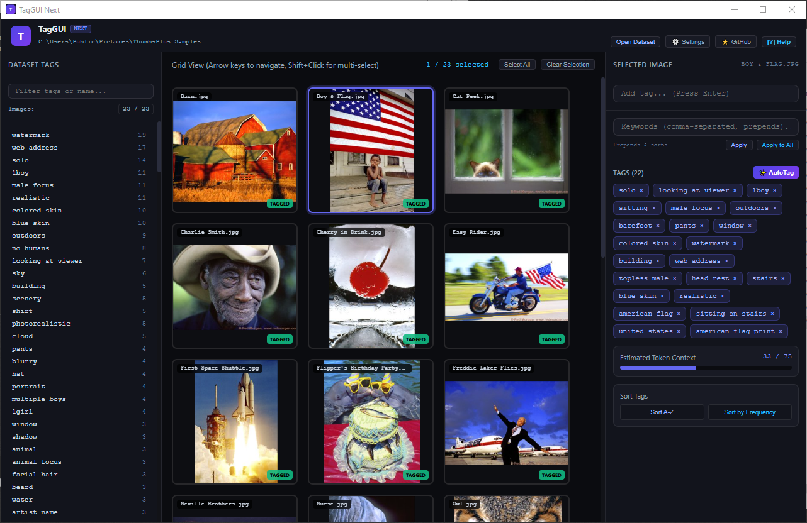
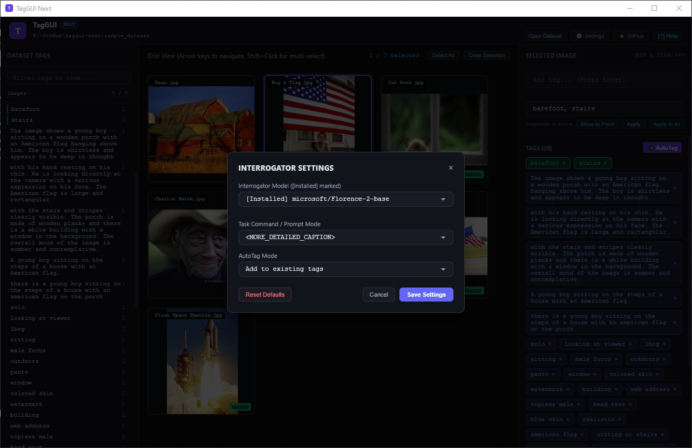

# TagGUI-Next


**TagGUI-Next** is a fast, modern, and self-contained local dataset manager and tagger built with **PySide6**, **PyTorch**, and **timm**. Designed to replace the aging [TagGUI](https://github.com/jhc13/taggui)  and [BooruDatasetTagManager](https://github.com/starik222/BooruDatasetTagManager) , in my personal workflows. It provides an intuitive HTML5/JavaScript GUI powered by `QWebChannel` for effortless tagging, bulk editing, and dataset organization for machine learning models (such as Stable Diffusion).

**TagGUI-Next** by default uses SmilingWolf / wd-eva02-large-tagger-v3 for an image interrogator. It's best for danbooru/e621 style tags, useful in preparation of image datasets for LoRa Training (for Pony XL v6/ Illustrious/ NoobAi and SDXL 1.0).

**TagGUI-Next** is tested to work with masive models like BLIP-2

---




## Key Features

- **Local PyTorch Tagger**: Powered by local models (like `wd-eva02-large-tagger-v3`) with full CUDA 13 support—no external API servers required.
- **Modern HTML5/JS GUI**: Clean, responsive, dark-themed interface running smoothly via Qt WebEngine.
- **Advanced Tag Management**:
  - Global tag list with usage counts and search/filter.
  - Double-click to rename tags globally across all images.
  - Drag-and-drop tag reordering on active images.
  - Multi-select support (Shift+Click and Ctrl+Click).
- **Keyword & Strategy Management**: 
  - Define custom training keywords that prepend and auto-sort.
  - Configure AutoTag behavior to either **Add** or **Replace** existing tags via a built-in Settings modal.
- **Token Estimation**: Real-time context token counter with visual warning thresholds for prompt limits (e.g., 75 tokens).
- ** Robust Undo/Redo History**: Comprehensive history stack supporting `Ctrl+Z` and `Ctrl+Shift+Z` across tag edits, additions, and deletions.
- **Comprehensive Keyboard Shortcuts**: Fast navigation and workflow control using arrow keys, shortcuts, and batch selection.

---
## Controls

- Arrow Keys,Navigate through dataset images
- Shift + Click,Multi-select range of images / add tag to selection
- Ctrl + Click on a tag,adds keyword to the keyword list
- Ctrl + Alt + Click on a tag, removes keyword to the keyword list
- Shift + Click on a global tag (the left tag list), adds the tag to the image tags
- Shift+ Alt + Click on a global tag (the left tag list), removes the tag from the image tags
- double click on a tag opens an edit tag window.
- drag-and-drop image tags in the right panel to re-order them
- Delete / Backspace,Delete selected global tag from all images
- Escape,Clear filters and selections
- Ctrl + Z / Ctrl + Shift +Z , Undo/Redo commands
    
---
## Usage

Load the directory containing your images Dataset by clicking the `Open Dataset`
button in the top right of the window. Tags are loaded from `.txt` files in the directory with the same names as the
images.Any changes you make to the tags are also automatically saved to these `.txt`
files.

## Automatic Captioning

In addition to manual tagging, you can automatically generate captions or tags
for your images inside ***TagGUI-Next***.

The default image interrogator is [SmilingWolf's](https://huggingface.co/SmilingWolf) [(wd-eva02-large-tagger-v3)](https://huggingface.co/SmilingWolf/wd-eva02-large-tagger-v3) model,
It will be downloaded automatically on the first use (about 1.2GB, be patient and wait it to be instaled)

GPU generation requires a compatible NVIDIA GPU, the CPU generation is also
supported as a fallback.

To use the feature, select the images you want to caption in the image list,
then click the AutoTag button.

To change the interrogator settings click the settings button 
>


---
##  Pro-Tip for Massive Models (BLIP-2 / Qwen 7B)
If your GPU has limited VRAM (e.g., 8GB or 12GB), running massive 7B-parameter captioning models alongside PySide6/WebEngine can easily hit out-of-memory (OOM) limits. If you experience freezes or crashes with larger vision models, consider:

- Using smaller, lightweight alternatives like Moondream2 (vikhyatk/moondream2) or Florence-2-base (microsoft/Florence-2-base-ft) which load lightning-fast and run comfortably under 4–6GB VRAM.

- Keeping the SmilingWolf Taggers for fast, high-performance tag management

---
## Installation & Setup

**Clone the repository:**
   ```bash
     git clone https://github.com/ViTa-Plane/taggui-next.git
     cd taggui-next
  ```
- run install.bat to automatically set the python_embeded and to  install the requirements (about 3.72GB)
- start the TagGUI-Next with run.bat
- on first use, the auto-tagger will download the default interrogator [(wd-eva02-large-tagger-v3)](https://huggingface.co/SmilingWolf/wd-eva02-large-tagger-v3) to the local huggingface hub directory (about 1.2GB)
- tested in Python 3.13.15 enviorement,
    ```
    Package            Version
    ------------------ ------------
    huggingface_hub    0.36.2
    Pygments           2.21.0
    PySide6            6.12.0
    PySide6_Addons     6.12.0
    PySide6_Essentials 6.12.0
    PySide6_Pdf        6.12.0.140
    PySide6_WebEngine  6.12.0.140
    timm               1.0.30
    tokenizers         0.22.2
    torch              2.14.1+cu130
    torchvision        0.29.1+cu130
    tqdm               4.70.1
    transformers       4.57.6
    ```
## Models compatibility 

**TagGUI-Next** uses  **Transformers v4.57.6** . Because v4.5x sits firmly past the major structural overhauls (where legacy cache managers, base mixins, and configuration validation rules were heavily modernized), some models in the auto-tagger pipeline might cause problems.

### 1. Florence-2 (`microsoft/Florence-2-...`)

* **Compatibility Status**: Stable (with flags).
* **Potential Gotchas**: Florence-2 uses custom architecture code (`code_florence_2.py`) loaded via `trust_remote_code=True`. On post-v4.50 packages, it can throw flash-attention or cache mismatch warnings if not explicitly told to use eager execution.
* **Current Defense**: my code already passing `attn_implementation="eager"` and `use_cache=False`, which completely shields it from breaking changes.

### 2. Moondream2 (`vikhyatk/moondream2`)

* **Compatibility Status**: **Fixed & Stable** (using  dynamic monkey-patches).
* **Potential Gotchas**: Built on a `PhiForCausalLM` remote-code text backend, it was the heaviest hit by `GenerationMixin` removal, `_from_model_config` checks, and `DynamicCache` deprecations (`seen_tokens`, `get_max_length`, `get_usable_length`).
* **Current Defense**: a comprehensive wrapper handles config mapping, cache properties, and generation fallback dynamically on load.

### 3. BLIP / BLIP-2 (`Salesforce/blip-...`)

* **Compatibility Status**: **Generally Safe**, but with a small caveat.
* **Why**: Unlike Florence-2 or Moondream, standard BLIP and BLIP-2 use official mainstream classes built directly into `transformers` (`BlipForConditionalGeneration`, etc.) rather than external `trust_remote_code` scripts. However, older checkpoints can occasionally throw warnings if their internal vision encoders or text query tokens expect legacy processor fields.
* **Watch out for**: Tokenizer maximum length handling or deprecated image processor kwargs (`images` vs `pixel_values`), though these usually throw soft deprecation warnings rather than hard crashes.

### 4. WD Tagger (Hugging Face / timm-based variants)

* **Compatibility Status**: Safe.
* **Why**: WD Tagger models (such as `SmilingWolf/wd-v1-4-moat-tagger` or `swinv2` variants) are typically built on top of standard image classification backends via `timm` or standard `AutoModelForImageClassification`. Because they don't use text-generation loops or custom `DynamicCache` generation structures, they largely bypass the breaking changes introduced in modern `transformers` releases.

---

Since we are locked to `transformers v4.57.6`, any *new* vision-language or causal model we integrate that relies on `trust_remote_code=True` will likely share Moondream's DNA (custom text models divorced from `GenerationMixin` or customized caches).

### My conclusion:
- use  WD Tagger models for speed and stability for danbooru / e621 style tags used in SDXL models
- use BLIP and Florence-2 for natural language prompts for FLUX/Qwen models.
- it's a lot of work and monkey-patching to keep the old models working
- keep it simple...stupid

### To do list:
-  auto-complete  danbooru / e621 style tags in  'add a tag' function
-  better keyboard shortcuts (i dunno, i need feedback)
-  ?
-  profit 
